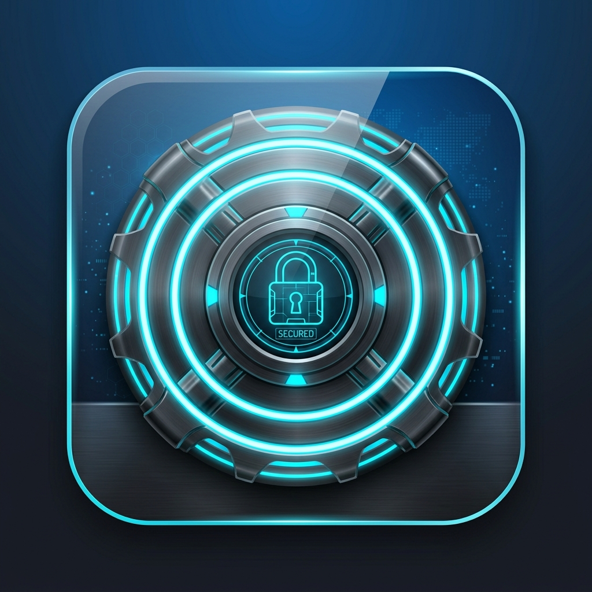
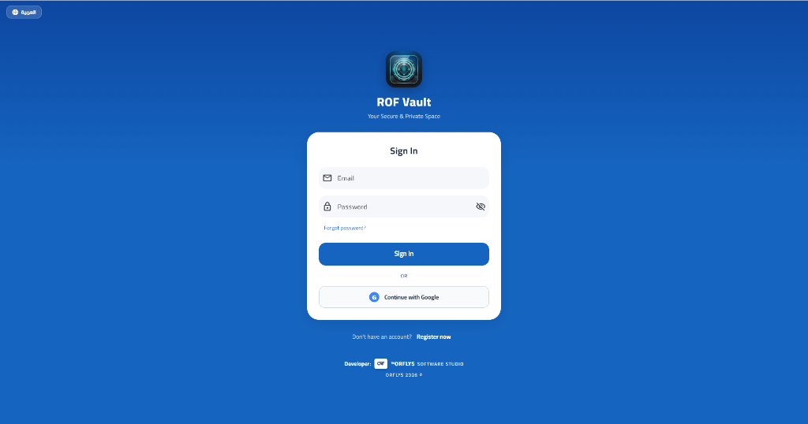
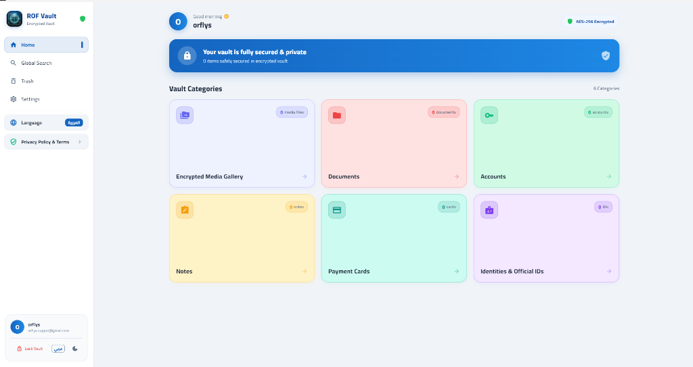
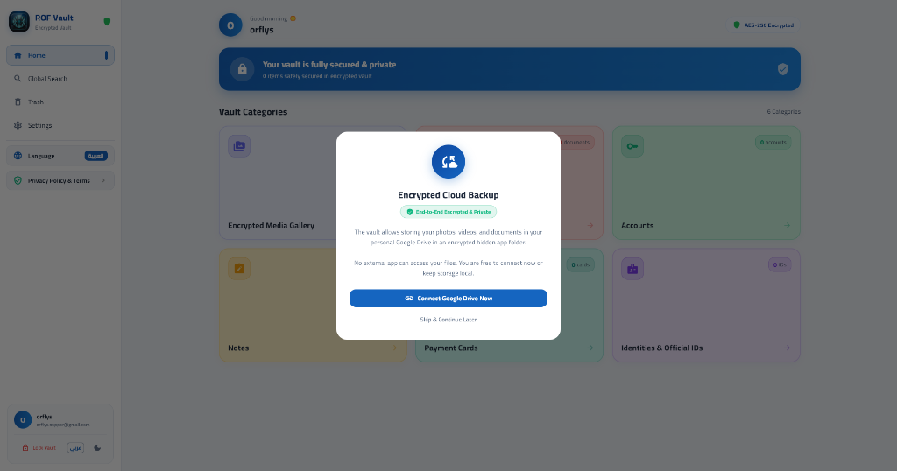
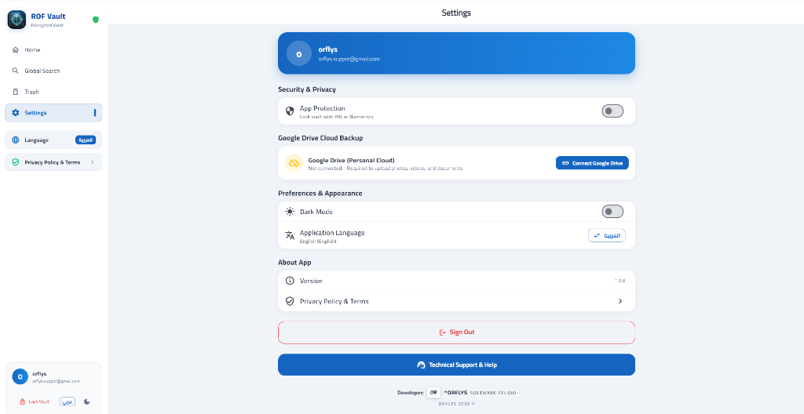
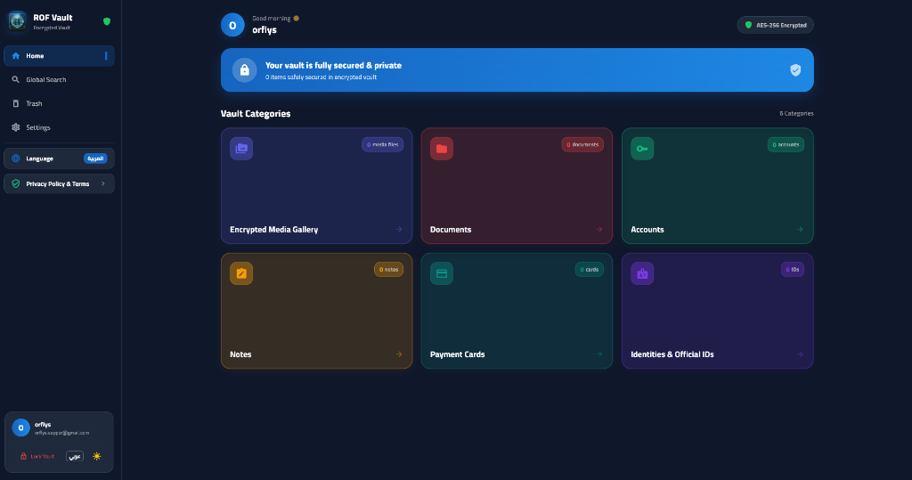

<p align="center">
  
</p>

<h1 align="center">ROF Vault</h1>

<p align="center">
  <b>Military-Grade Personal Digital Vault for Windows</b><br>
  <i>خزنة رقمية مشفرة وفائقة الأمان لنظام ويندوز لحماية بياناتك وملفاتك الحساسة</i>
</p>

<p align="center">
  
  
  
  
</p>

<p align="center">
  <a href="https://apps.microsoft.com/detail/9nfq9t88z30m" target="_blank">
    
  </a>
</p>

---

## 📖 Overview | نبذة عن البرنامج

**ROF Vault** is an advanced, ultra-secure personal digital vault designed natively for Windows 10 and Windows 11. Built with military-grade **AES-256-GCM** encryption and an **offline-first** philosophy, ROF Vault gives you complete control over your private files, credentials, documents, and notes without third-party tracking, telemetry, or ads.

**برنامج ROF Vault** هو خزنة رقمية شخصية متطورة وفائقة الأمان مخصصة لأجهزة نظام Windows، مصممة لحماية بياناتك وملفاتك الحساسة بأعلى معايير الخصوصية والتشفير. يعتمد البرنامج على خوارزمية التشفير العسكري **AES-256-GCM** مع بنية تعمل محلياً بالكامل دون أي تعقب أو إعلانات.

---

## 📥 Download from Microsoft Store | التحميل الرسمي

The official way to download, install, and receive automatic updates for **ROF Vault** is through the **Microsoft Store**:

<p align="center">
  <a href="https://apps.microsoft.com/detail/9nfq9t88z30m" target="_blank">
    
  </a>
</p>

* ✅ **Automatic Updates:** Always run the latest release with zero manual hassle.
* ✅ **Microsoft Verified:** Scanned, certified, and digitally signed for Windows.
* ✅ **100% Free & Private:** No ads, no hidden subscriptions, and zero tracking.

---

## 📸 Screenshots | لقطات الشاشة الرسمية

<div align="center">
  <table>
    <tr>
      <td width="50%">
        <b>🔐 Sign In & Authentication</b><br>
        
      </td>
      <td width="50%">
        <b>🗂️ Vault Dashboard (Light Mode)</b><br>
        
      </td>
    </tr>
    <tr>
      <td width="50%">
        <b>☁️ Encrypted Cloud Backup (Google Drive)</b><br>
        
      </td>
      <td width="50%">
        <b>⚙️ Settings & Security Controls</b><br>
        
      </td>
    </tr>
    <tr>
      <td colspan="2" align="center">
        <b>🌙 Vault Dashboard (Dark Mode)</b><br>
        
      </td>
    </tr>
  </table>
</div>

---

## ✨ Key Features | المميزات الرئيسية

* 🛡️ **Military-Grade Encryption:** Local AES-256-GCM cryptographic protection ensures data is encrypted before reaching disk or cloud.
* 📦 **6-in-1 Comprehensive Vault:**
  * **🖼️ Media Gallery:** Secure viewing and storage of private photos and videos.
  * **📄 Documents Locker:** Confidential PDF and file storage.
  * **🔑 Passwords & Accounts:** Organized credentials manager with quick-copy buttons.
  * **📝 Encrypted Notes:** Secure notepad for private ideas, recovery seeds, and memos.
  * **💳 Payment Cards:** Encrypted storage for debit/credit card details.
  * **🪪 Identity Records:** Safe storage for national IDs, passports, and licenses.
* ☁️ **Encrypted Google Drive Backup:** Seamless, zero-knowledge cloud backup and restore. Files are fully encrypted before leaving your machine.
* ⏱️ **Intelligent Auto-Lock:** Configurable inactivity timers to automatically lock your vault.
* 🌐 **Offline-First Privacy:** Zero ads, zero background telemetry, and zero tracking. Your data stays with you.
* 🖥️ **Windows Desktop Native UI:** Optimized with mouse controls, right-click context menus, physical keyboard support, and Light/Dark theme switching.

---

## 🔒 Security Architecture | معمارية الأمان

```
[ User Input / Files ]
         │
         ▼
[ PBKDF2 Key Derivation + Master Key / PIN ]
         │
         ▼
[ AES-256-GCM Authenticated Encryption ]
         │
    ┌────┴───────────────────────────┐
    ▼                                ▼
[ Local Encrypted Storage ]   [ Encrypted Cloud Sync (Google Drive) ]
(Zero Plaintext on Disk)       (Zero-Knowledge to Provider)
```

1. **Client-Side Encryption:** All encryption/decryption keys are derived on the client machine using cryptographically secure algorithms.
2. **Encrypted at Rest:** Data on disk remains completely unreadable without the user's master credentials.
3. **Safe Cloud Sync:** Google Drive backup sends ciphertext only; Google never receives decryption keys or plaintext content.

---

## 💻 System Requirements | متطلبات التشغيل

* **Operating System:** Windows 10 (64-bit) / Windows 11 (64-bit)
* **Processor:** 1.5 GHz or faster (x64)
* **Memory:** 2 GB RAM (4 GB recommended)
* **Storage:** 200 MB free disk space

---

## 👨‍💻 Developer & Publisher

* **Publisher:** [ORFLYS](https://orflys.com)
* **Website:** https://orflys.com
* **Store Product:** [ROF Vault on Microsoft Store](https://apps.microsoft.com/detail/9nfq9t88z30m)

---

<p align="center">
  <sub>Copyright © 2026 <b>ORFLYS</b>. All rights reserved.</sub>
</p>
